# CS329A · Lectures 1–4 — Agent architectures, end to end

A map of the first four lectures of Stanford CS329A *Self-Improving AI Agents* (Autumn 2025): every architecture they cover, how it works, its pros and cons, and where Homework 1 uses it.

**How to read it**
- **L2 [0:16:39]** means Lecture 2, 16 min 39 s into the video. Every lecture claim carries one, so you can jump to it.
- *(my note)* marks my own explanation or estimate. It is not something said in the lecture.
- The running example uses made-up numbers. Lecture results use the lecturers' numbers.

| Lecture | Video | The one-line takeaway |
|---|---|---|
| L1 · Course Overview | [watch](https://www.youtube.com/watch?v=6YnLB0XbTnI) | Bigger pre-training is slowing down; the next gains come from compute spent while answering, from feedback, and from agents. |
| L2 · Test-Time Compute Scaling | [watch](https://www.youtube.com/watch?v=-Ggc37xLj_Y) | With many attempts a right answer usually appears somewhere; choosing it is the hard part. |
| L3 · Robust Verification | [watch](https://www.youtube.com/watch?v=p7TdPUcPoik) | How to build graders that choose well: from answer keys, to step-by-step graders, to panels of weak graders. |
| L4 · Learning from Feedback with Tools/Code | [watch](https://www.youtube.com/watch?v=Lxh9RF5S-K0) | Feedback can come from tools, from running code, or from a written rulebook, and models can be trained to use it. |

**Contents:** 1 The whole block in one picture · 2 One example to carry through · 3–9 The seven families (A–G) · 10 Side-by-side comparison · 11 Ten lessons that cut across the lectures · 12 Which architecture when? · 13 Homework 1 map · 14 Open questions · 15 Glossary · 16 Official readings

---

## 1. The whole block in one picture

**What we're doing here, and why.** The four lectures name more than thirty methods, but they are all one loop with different parts plugged in. The model makes attempts. Something gives feedback on them. The feedback is then used either to produce a better answer right now (the *inner loop*) or to train a better model (the *outer loop*) (L4 [0:28:37], [0:33:41]).

One metaphor runs through this guide: **the model is a student sitting an exam.**

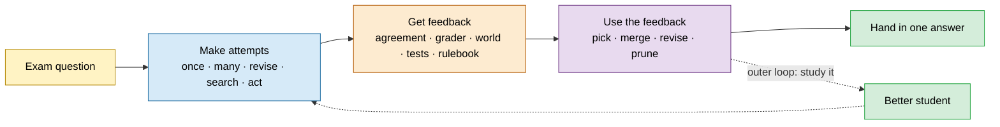

Every architecture answers three questions:

| Question | The options in Lectures 1–4 |
|---|---|
| **How are attempts made?** | once · many in parallel · one after another (revision) · as a tree (search) · interleaved with actions (agents) · in stacked layers |
| **Where does the feedback come from?** This is L4's organizing question [0:01:05]. | nowhere · agreement between attempts (voting) · an automatic checker (unit tests, a proof checker) · a trained grader (ORM, PRM) · another LLM call (judge, critic) · a panel of graders · the world, through tools · running the code · a written rulebook · human ratings |
| **What is the feedback used for?** | pick one attempt · merge attempts · revise an attempt · prune a search · **train the model** |

The seven families below follow the first question. The second and third questions explain most of each family's pros and cons.

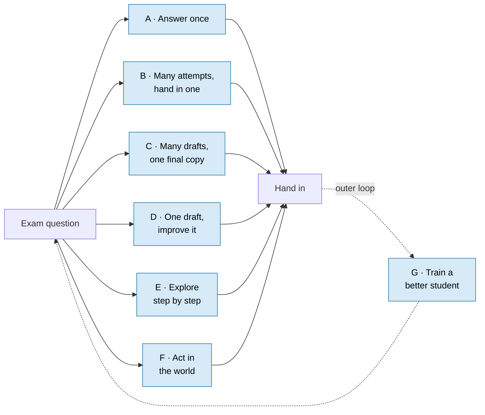

---

## 2. One example to carry through

**Made-up numbers, used in every section.** The model solves one AIME problem 16 times. The true answer is **108**.

| Answer given | 42 | **108** | 17 | three other answers |
|---|---|---|---|---|
| How many times | 6 | **4** | 3 | 1 each |

Three numbers describe what happened (L1 [0:20:26]–[0:23:31], [0:35:46]):
- **pass@1**: the chance that a single attempt is right. Here 4/16 = **25%**.
- **coverage (pass@k)**: is *any* of the k = 16 attempts right? **Yes.** This is what a perfect checker would score.
- **selected accuracy**: is the *one answer you hand in* right? That depends entirely on how you choose. A majority vote hands in 42, so **no**.

The distance between "a right answer exists" (coverage) and "the answer we picked is right" is the **generation–verification gap** (L2 [0:14:38]–[0:18:48]). Most of Lectures 2 and 3 is about closing it.

The formula behind it (optional)

For one problem where each attempt is right with probability p, all k attempts are wrong with probability (1 − p)^k, so coverage = 1 − (1 − p)^k. With p = 0.25 and k = 16 that is 1 − 0.75^16 ≈ 0.99.

Averaged over a whole dataset, coverage grows far more slowly, like a power law. The reason is a long tail of problems where p is tiny (L2 [0:07:19]–[0:10:21]). Watch out at L2 [0:08:19]: the captions say "1 minus p" for the probability that all k attempts fail; the correct expression is (1 − p)^k.

---

## 3. Family A — Answer once

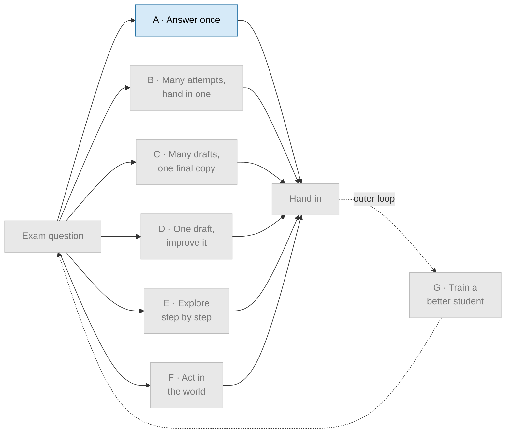

**What we're doing here, and why.** These are the baselines: one attempt per question, no extra compute while answering. Everything later is measured against them.

### A1 · Zero-shot and few-shot prompting — "one shot at the exam"
- **How:** describe the task in the prompt (zero-shot), optionally with a few solved examples (few-shot). The model continues the pattern; no weights change (L1 [0:05:10]–[0:06:10]).
- ✅ No training; instant to prototype. Large models picked this ability up with scale (L1 [0:05:10]).
- ❌ One draw, no way to recover from a bad one. Its accuracy *is* pass@1.
- **Example:** a 25% chance of handing in 108.

### A2 · Chain of thought — "show your working"
- **How:** examples (or an instruction) that spell out intermediate steps, so the model writes steps before its answer (L1 [0:07:12]–[0:09:12]).
- ✅ Big gains for large models on math. It underlies every reasoning model and "is holding to this day" (L1 [0:09:12]).
- ❌ In the plotted model families, the ~7–8B models got no benefit (L1 [0:09:12]).
- ❌ Every step comes from the model's memory, with nothing checking it, so it can hallucinate confidently. Hallucination was chain of thought's main failure mode in ReAct's error analysis (L4 [0:04:08], [0:19:20]).

### A3 · Reasoning models — "a student trained to check their work while writing"
- **How:** the model writes its own long trace: it analyses the problem, splits it into subtasks, tries something, checks it, notices "wait … there's something wrong", and backtracks (L1 [0:30:38]–[0:33:43]). Thinking longer raises pass@1 roughly log-linearly with compute (o1's AIME plot, L1 [0:29:38]–[0:30:38]).
- ✅ One call does internally what families B–D do from the outside. Beats GPT-4o on math, data analysis and programming (L1 [0:30:38]–[0:34:45]).
- ❌ Long traces are expensive, and they are not necessarily better on personal writing or text editing (L1 [0:30:38]–[0:34:45]).
- ❌ The self-correction mostly comes from training — fine-tuning and RL on synthetic data — not from prompting (L1 [0:32:41]).
- **HW1:** §4 imitates this loop from the outside with prompts. Expect less than a trained model achieves *(my note, based on L1 [0:32:41])*.

---

## 4. Family B — Many attempts, hand in one

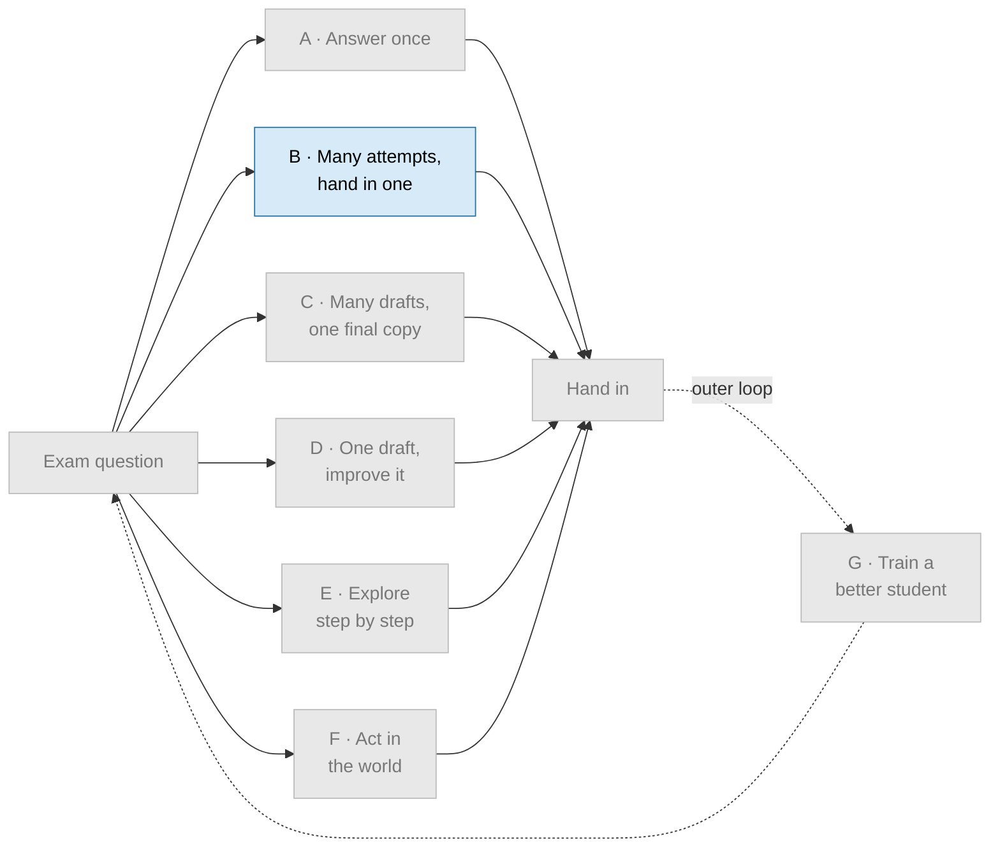

**What we're doing here, and why.** A fixed model knows more than one attempt shows (L1 [0:23:31]). Ask the same question many times, then choose one answer. Every member of this family is the same picture; only the chooser changes.

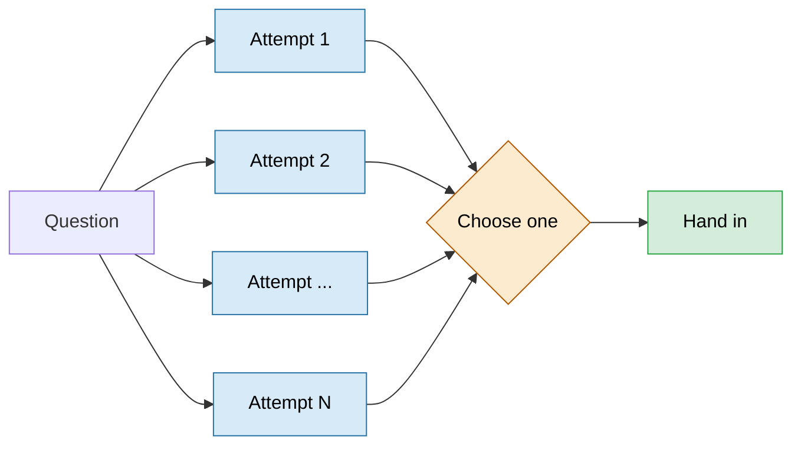

The attempts differ because generation is random; *temperature* sets how random. Above about 1.2 "it's not great", and much higher gives gibberish (L1 [0:21:26], [0:27:35]).

### B1 · Repeated sampling with an automatic checker — "many attempts and an answer-checking machine"
- **How:** sample the question k times. An automatic checker marks the correct attempts: unit tests, a formal proof checker, or running a generated program and a reference program on the same inputs and comparing outputs. Return a correct one (L1 [0:20:26]–[0:23:31]; L2 [0:01:05]–[0:04:12], [0:11:30]–[0:14:38]). Paper: *Large Language Monkeys*.
- ✅ Accuracy equals coverage, which keeps rising up to 10,000 samples. Small open models then beat GPT-4o's single answer (L1 [0:22:28]).
- ✅ Predictable: a fitted scaling law forecasts how many samples a target coverage needs, from 70M- to 70B-parameter models (L2 [0:04:12]–[0:07:19]).
- ✅ The attempts run in parallel, so waiting time stays manageable (L1 [0:25:33]).
- ✅ Where a checker exists, checking can be the easy part: a unit test can be simpler to write than the program (L2 [0:12:32]); KernelBench's output comparison is "by default, perfect" (L2 [0:14:38]).
- ❌ Only exists in checkable domains such as code and formal math. Tests that don't cover the code let wrong programs pass (L2 [0:25:54]).
- ❌ Cost grows in proportion to k.
- **Example:** the checker finds a 108 → right.
- **HW1:** you *do* have such a checker, the AIME answer checker, but only for grading. Using it to choose would be cheating: that is the "oracle" (see B7).

### B2 · Majority voting — "hand in your most common answer"
- **How:** extract the final answer from each attempt and return the most frequent one. The reasoning text is ignored. It is the same method as *self-consistency* (SC, CoT-SC) (L2 [0:15:38]; L3 [0:32:54], [0:44:09]; L4 [0:17:19]).
- ✅ Needs no grader, no extra model and no labels. Works on many easier sets such as GSM8K (L2 [0:16:39]).
- ✅ In *Let's Verify* it held up better than a trained outcome grader when test problems differed from training problems (L3 [0:30:53]).
- ✅ The vote share is a confidence signal: ReAct's hybrid switches to searching when the top answer gets less than half the votes (L4 [0:18:20]).
- ❌ Flattens early: after about 10–50 samples in *Large Language Monkeys*, far below coverage, and worse on harder data (MATH vs GSM8K) (L2 [0:16:39]).
- ❌ Can never surface a rare right answer. On the hardest problems the right answer may appear once, twice or three times in 1,000–10,000 samples, so it never wins (L2 [0:17:44]).
- ❌ Pools only what the model already knows, so it cannot fix an error the model makes consistently *(my note, after L4 [0:17:19])*.
- **Example:** 42 has 6 votes → hands in 42 → wrong. This is the generation–verification gap in one picture.
- **HW1:** §2. Voting works on AIME because every answer is a whole number from 0 to 999, so answers compare exactly *(my note)*.

### B3 · Best-of-N with an outcome reward model (ORM) — "a trained grader reads each finished paper"
- **How to build the grader:** take practice problems with known answers. Sample many solutions per problem (100 in Cobbe et al.), label each correct or incorrect by its final answer, and train a model to predict "is this solution correct?" (L3 [0:03:13]–[0:07:19]).
- **How to use it:** the grader reads each new solution — never the answer key — and scores it. Hand in the highest-scoring attempt (L2 [0:28:56]; L3 [0:14:26]).
- ✅ Can pick a right answer even when it is in the minority (L2 [0:16:39]).
- ✅ Its training labels come from answer keys, so no human has to grade solutions (L3 [0:04:15]).
- ✅ A small grader can serve a big generator: generator size mattered more than grader size (L3 [0:12:24]). The lecturer's reading is that checking may be easier than generating (L3 [0:13:24]).
- ✅ Steers a general model from the outside instead of specializing it with more fine-tuning (L3 [0:20:36]). (Cobbe et al. still fine-tuned their generator briefly first.)
- ✅ In Cobbe et al. it kept improving up to ~400 samples, where majority voting stalls much earlier (L3 [0:14:26]).
- ❌ **More attempts can hurt.** Accuracy *fell* at 800 samples: with more candidates, a wrong solution is more likely to fool the grader and score highest. They used 100 in practice (L3 [0:14:26], [0:17:29]).
- ❌ Judges the outcome, so it can reward a right answer reached by wrong reasoning (L3 [0:24:43]).
- ❌ Weaker on new domains, and still leaves a large gap to coverage (L2 [0:16:39], [0:28:56]).
- **Example:** a good grader hands in a 108 although 108 is in the minority → right.

### B4 · Best-of-N with a process reward model (PRM) — "a grader who marks every line"
- **How:** a model scores each step of a solution between 0 and 1. In *Let's Verify Step by Step*, a solution's score is the product of its step scores, so one bad step sinks it (L2 [0:28:56]–[0:33:02]; L3 [0:22:40]–[0:24:43]).
- **Where the labels came from:** humans marked steps positive, negative or neutral — 800K labels (PRM800K), collected with active learning that prioritized convincing wrong solutions (L3 [0:25:43]–[0:26:44]).
- ✅ Beat the outcome grader and majority voting as samples grew; majority voting failed after about 100 samples in that plot (L3 [0:28:45]).
- ✅ Found correct solutions even on problems where under 5% of samples were correct (L3 [0:29:49]).
- ✅ Catches right-answer-wrong-reasoning, needs fewer labels for the same quality, holds up best when test problems differ, and its judgements are interpretable (L3 [0:24:43]–[0:30:53]).
- ✅ Can judge a *partial* solution, so it can steer a search (family E) (L2 [0:29:56]).
- ❌ Human step labels are expensive, and it works best in the domain it was trained on (L2 [0:31:00]; L3 [0:28:45]).
- ❌ A generator *trained* to please it may learn to skip reasoning (L3 [0:35:54]).
- **Example:** it spots the step where the six 42-solutions went wrong and scores them low.

### B5 · LLM-as-a-judge — "ask a classmate to grade"
- **How:** prompt an LLM with a solution and ask whether it is correct; "the prompt could be literally that" (L3 [0:53:25]). Optionally give it a rubric to check each step against, and tools such as a calculator or SymPy (L3 [0:48:18]).
- ✅ No training, and it works anywhere, including where no checker exists (L1 [0:26:34], [0:46:55]).
- ✅ Tools add what trained graders lack: a calculator catches an arithmetic slip at once (L3 [0:48:18]).
- ❌ On its own it is one more imperfect ("weak") verifier. In Weaver's comparison, prompted LLMs scoring different aspects with a rubric did about as well as majority voting, or worse (L3 [1:01:40]).
- ❌ Models are overconfident about answers, including their own (L4 [0:13:13], [0:59:16]).
- **HW1:** §3. Your aggregator is an LLM judge used *comparatively*: one call reads all 16 solutions and restates the one it believes. The lecture's judges score one solution at a time.

### B6 · Weaver — "a panel of imperfect graders, each weighted by its track record"
- **How:** run many verifiers on every attempt: reward models and LLM judges, the two types in the lecture (L3 [0:52:25]–[0:53:25]). Put their scores on one scale and drop the weak ones. Then estimate how accurate each one is from the pattern of who agrees with whom (*weak supervision*, assuming their errors are independent once the true answer is fixed). This needs very few labels. Hand in the attempt with the highest combined probability of being correct (L3 [0:55:33]–[0:58:36]).
- ✅ Weighting beats simple averaging, whose gains were not even monotonic in the number of verifiers (L3 [0:53:25]–[0:54:31]).
- ✅ 8B models plus verifiers reached about 70% on average, roughly what 70B models get with majority voting. With 70B-class models it reached 86.2%, comparable to o3-mini (lecture figures, L3 [1:02:41]–[1:03:41]).
- ✅ A distilled version — a ~400M model trained to copy the panel — keeps about 97% of the accuracy with 99%+ less compute at answer time (L3 [1:04:43]).
- ❌ Cost multiplies with the number of verifiers (L3 [0:49:19]).
- ❌ Relies on the independence assumption and on filtering out weak verifiers; learning the weights needs at least a few labels.
- ❌ How to split a fixed budget between more attempts and more verifiers is still open (L3 [1:05:44]).
- The lecturer calls this "weak to strong supervision": many noisy labelers combined into one stronger label (L3 [0:56:35]).

### B7 · The oracle (pass@k) — "peek at the answer key"
- Not a method, a ceiling: count a question as solved if *any* attempt is right. It needs the ground truth, which is exactly why graders get built (L3 [1:00:37]).
- Coverage is the ceiling only for methods that *return one of the attempts*. A method that writes a new answer (family C, and HW1 §3) can in principle beat it — or garble a right one *(my note)*.

---

## 5. Family C — Many drafts, one final copy

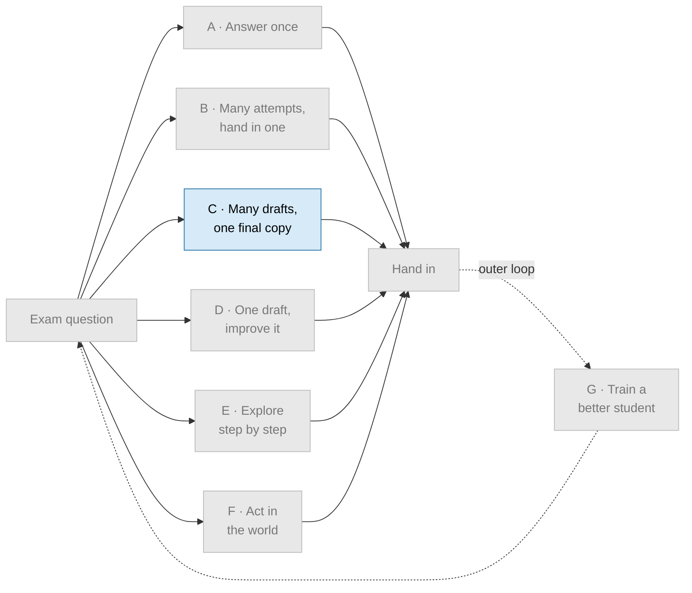

**What we're doing here, and why.** Instead of *picking* an attempt, an LLM can read all of them and write a better one. *Archon* treats prompted LLM calls as building blocks and stacks them in layers, like layers of a neural network (L2 [0:45:22]–[1:02:42]).

| Block | Exam metaphor | What the call does |
|---|---|---|
| Generator | write a draft | samples answers, possibly from several different models |
| Critic | a reviewer's margin notes | lists strengths and weaknesses of each answer |
| Ranker | sort the drafts | orders the answers from best to worst |
| Fuser | write the final copy from all drafts | reads the question plus K answers and writes one |
| Verifier | check with reasons | scores an answer and explains why |
| Unit-test generator + evaluator | write your own test, then mark against it | one call writes tests; another judges each candidate against them, without running anything |

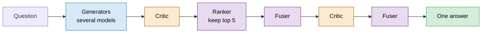

### C1 · Fusion and rank-then-fuse — "write the final copy from all your drafts"
- **How:** the fuser answers "while being aware of all the possible ways that this question is answered"; the lecture files it under *sequential update* on top of parallel samples (L2 [0:49:25]).
- ✅ On an open-ended question-answering benchmark scored by win rate, fusing 1–10 answers beat even an oracle that picks the best single answer; ranking first and fusing the top five was best (L2 [0:50:27]–[0:54:34]).
- ✅ Works across several different models, not just repeated samples of one (L2 [0:50:27]).
- ❌ Every block is another call. Order matters: a critic goes before any ranker or fuser (L2 [0:59:40]).
- ❌ On exact-answer tasks such as AIME, "beating the oracle" would mean re-solving a problem that none of the drafts got right. A fuser can also blend a right draft into a wrong answer *(my note)*.
- **Example:** reading all 16, the fuser may notice the 42-solutions double-count a case and re-derive 108 — or produce a confused mix.

### C2 · Layered stacks — "a full exam strategy built from these moves"
- ✅ Adding more layers of critics and fusers improved results further (L2 [0:58:38]).
- ✅ Archon beat GPT-4o and Claude 3.5 Sonnet by 14.1 points on average across instruction following, reasoning, math and coding, comparing one final answer each (L2 [1:00:41]–[1:02:42]).
- ❌ That comparison matched *one final answer*, not cost: Archon makes many calls where the frontier model makes one (L2 [0:57:38]). Report cost separately *(my note)*.

### C3 · Searching for the stack — "find the best strategy within a time limit"
- **How:** given benchmarks, a budget of calls, the available models and the blocks, a search (Bayesian optimization) tries layered designs on a training set and maximizes accuracy against the number of calls. Rules: one technique per layer, a generator first, a critic before any ranker or fuser, a test generator followed by an evaluator (L2 [0:56:37]–[0:59:40]).
- ✅ Needs fewer trials than greedy or random search, and can be tuned for one task or for general use (L2).
- ❌ The search itself costs a great many calls, so the space was trimmed by hand (L2).

### C4 · Tests written and judged by an LLM — "write your own test, then mark against it"
- ✅ Creates a verifier where none exists. Part of Archon's coding stack, and the lecturer suggests it beyond code, for math and reasoning too (L2 [0:54:34]).
- ❌ The model's judgement stands in for actually running the tests and can be wrong; the lecturer calls the idea "even crazier" (L2 [0:54:34]).

---

## 6. Family D — One draft, improve it

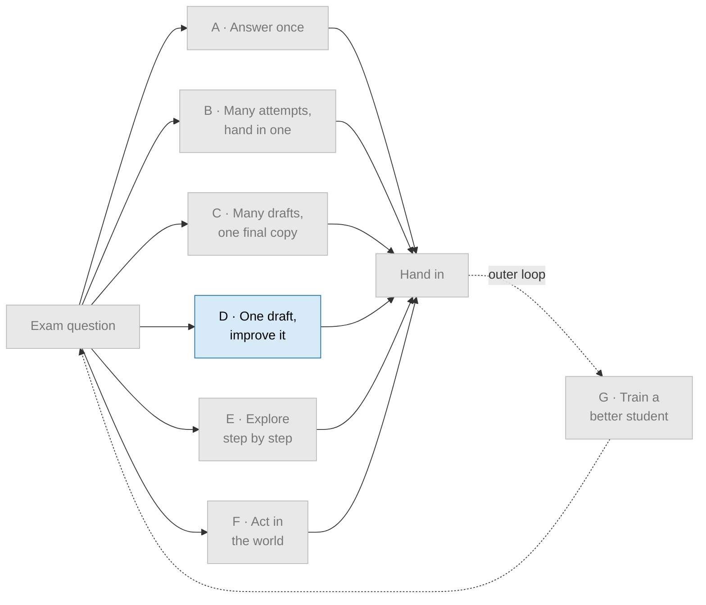

**What we're doing here, and why.** Family B is *parallel*: many independent attempts. This family is *sequential*: one attempt, improved step by step using feedback (L2 [0:26:55]–[0:27:55]).

### D1 · Sequential revision — "rewrite your draft"
- **How:** ask the model to revise its answer, looking at it from different angles, until it is confident (L2 [0:26:55]–[0:27:55]). In Snell et al. a fine-tuned model wrote the revisions; today any instruction-tuned model revises when asked (L2 [0:35:02]). Variant: several revision chains in parallel, with a grader picking the final answer (L2 [0:33:02]–[0:35:02]).
- ✅ Was the best use of compute on easier problems (L2 [0:34:02]–[0:37:06]). Reasoning models now do this internally.
- ❌ On the hardest problems, the best split between revising and sampling was unclear (L2 [0:37:06]). The class's intuition was that hard problems need more parallel exploration (L2 [0:43:22]).
- ❌ Each revision waits for the previous one, so it is slower than parallel sampling *(my note)*.

### D2 · Critique, then rewrite — "a reviewer's notes, then a rewrite"
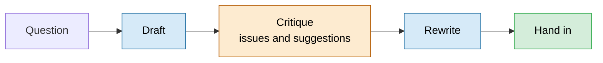
- **How:** draft; a critic call lists strengths and weaknesses (Archon's critic, L2 [0:49:25]); a rewrite call gets the problem, the previous answer and the feedback — the same shape as RLEF's inner loop: "this is the output you generated, and this is the feedback you got" (L4 [0:29:37], [0:33:41]–[0:34:42]).
- ✅ Cheap (three calls per round) and needs no training. Can rescue a wrong draft.
- ❌ The critic is an LLM judge: overconfident and sometimes wrong (L4 [0:13:13]).
- ❌ In RLEF, models that were not trained for it gained little from feedback; using feedback is a skill that training teaches (L4 [0:35:44]).
- ❌ Unlike RLEF there is no "tests passed, stop" signal, so a correct answer can be "fixed" into a wrong one *(my note, contrasting with L4 [0:30:38])*.
- **Example:** the critic points at the double-counted case in a 42-draft → rewrite gives 108, a fix. Or the critic nitpicks a 108-draft → rewrite gives 112, a regression.
- **HW1:** §4. The lecturer frames it as RLEF's idea applied to math: find the error in a solution instead of running code (L4 [0:34:42], [0:36:47]).

### D3 · The execution-feedback loop — "run your program on the sample tests, read the error, fix it"
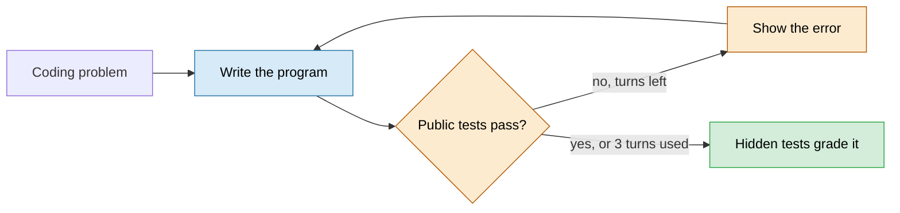
- **How:** write code; run the small set of *public* tests; if they fail, append the code and the test output to the conversation and generate again. Stop when the public tests pass or after 3 attempts. The final program is graded on hidden *private* tests (L4 [0:28:37]–[0:31:38]).
- ✅ The feedback is factual: what failed, with no guessed advice on how to fix it (L4 [0:37:47]).
- ✅ It has a natural stop signal (tests pass), and the hidden tests cannot be gamed or leak into the feedback (L4 [0:31:38], [0:41:52]).
- ❌ Needs executable tests. And base models make poor use of the error message until RL teaches them (L4 [0:35:44]) — see G7.

### D4 · Compute-optimal allocation — "spend your time where it pays"
- **How:** estimate each problem's difficulty, then per difficulty pick the strategy (grader type, ratio of revising to sampling) that reaches each accuracy with the smallest budget. Snell et al. sorted problems into five bins by pass@1 (L2 [0:34:02]–[0:39:09]).
- ✅ For easy and medium questions, extra compute at answer time beat scaling up pre-training (L2 [0:38:08]–[0:42:22]).
- ❌ The bins came from ground truth over many samples; a real system has to *predict* difficulty (L2 [0:35:02]).
- ❌ On the hardest questions a bigger pre-trained model still won at matched compute — "still a work in progress" (L2 [0:37:06]–[0:38:08]).

---

## 7. Family E — Explore step by step

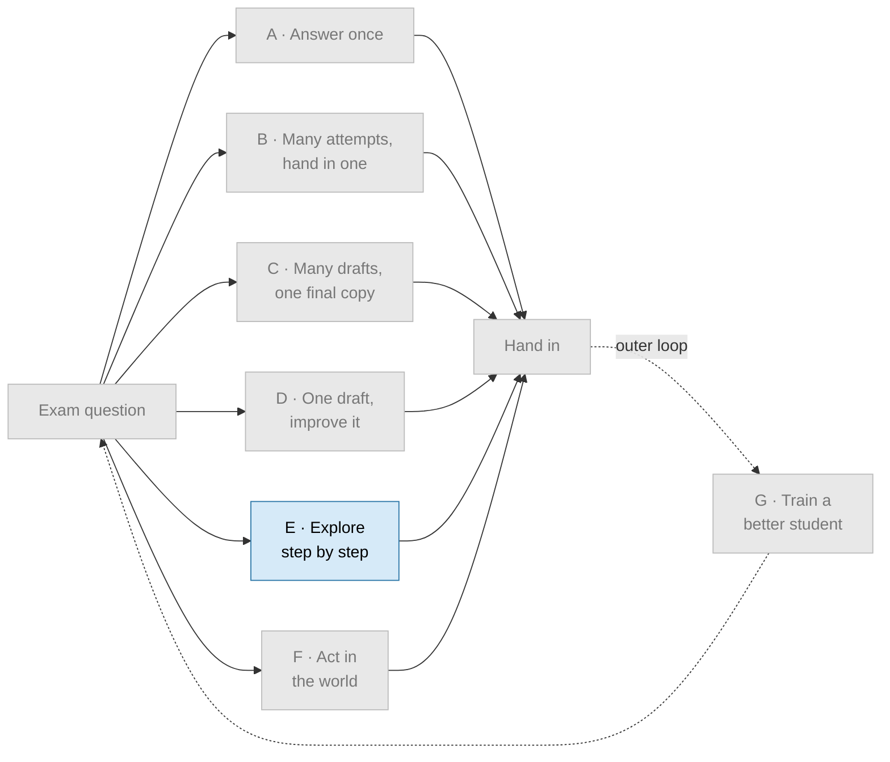

**What we're doing here, and why.** A step grader (B4) can judge *half-finished* solutions, so it can steer the writing while it happens instead of only judging finished papers.

### E1 · PRM-guided beam search — "try a few next lines, keep the best two, repeat"
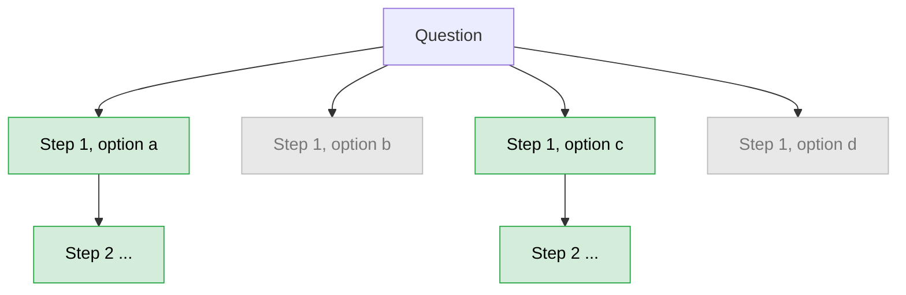
- **How:** at each step, sample a few continuations (for example 4), score them with the step grader, keep the best (for example 2), expand those, and repeat until the solution is finished (L2 [0:29:56]–[0:31:00]).
- ✅ Spends compute only on promising branches and prunes the rest.
- ❌ Only as good as the step grader, and how best to combine it with other methods is still open (L2 [0:29:56]–[0:31:00]).
- **Example:** if the grader dislikes the step where the 42-solutions double-count, those branches are cut early.

---

## 8. Family F — Act in the world

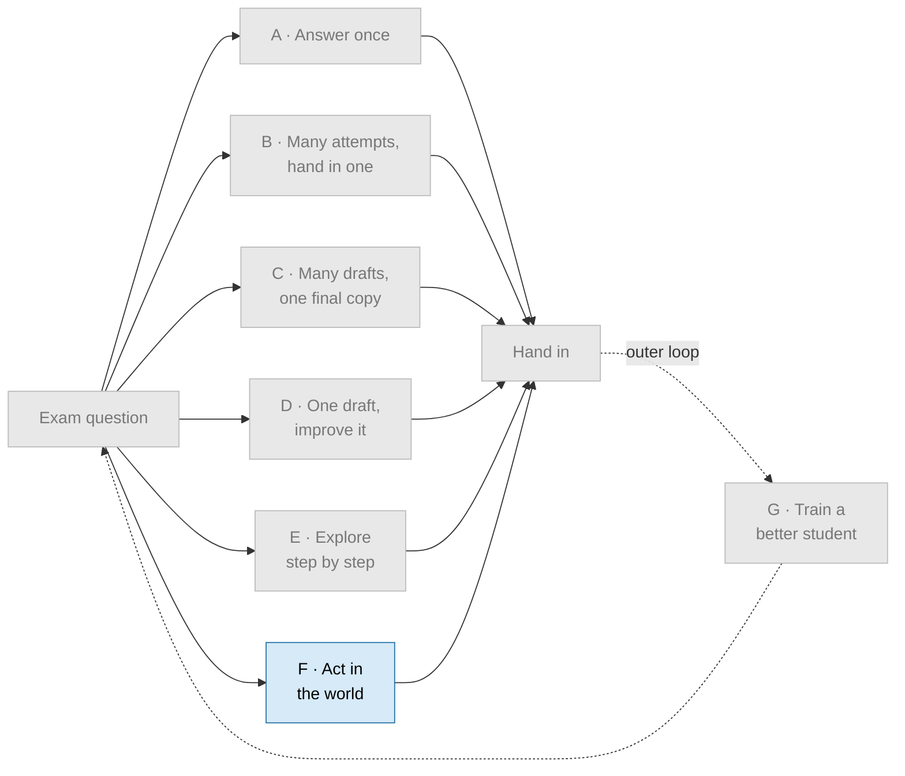

**What we're doing here, and why.** So far the student only used their own head. An **agent** gets a goal, takes actions — often tool calls such as a web search or a terminal — reads the feedback, corrects itself, and decides when it is done. It may need memory to keep track (L1 [0:41:53]–[0:42:53]).

### F1 · Acting without thinking (Act-only, WebGPT-style) — "looking things up with no plan"
- ✅ Brings in outside information (L4 [0:04:08]).
- ❌ Loses the thread: in the Apple Remote example it finds the facts but cannot produce a good answer (L4 [0:10:11]).

### F2 · ReAct — "an open-book exam: think, look up, read, think again"
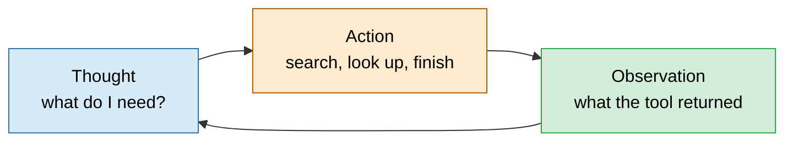
- **How:** a frozen model with a few example trajectories in its prompt loops Thought → Action → Observation. When a search fails, the next thought rephrases it ("Front Row" → "Front Row software") (L4 [0:05:08]–[0:14:13]).
- ✅ Grounded in looked-up facts, so it hallucinates less, and its trace is easy to read (L4 [0:04:08]).
- ✅ No training at all, yet on WebShop it beat trained imitation learning and imitation learning plus RL (L4 [0:20:21]).
- ❌ Not always better than chain of thought: it wins on FEVER but not always on HotpotQA (L4 [0:18:20]).
- ❌ Long tasks compound errors: on WebShop it scored 66.6 against human experts' 82.1, and its success rate was lower still, which the lecturer puts down to errors cascading across steps (L4 [0:21:22]).
- ❌ Large action spaces need more examples than fit in the prompt, and every step is another call (L4).
- **Example:** AIME problems are self-contained, so web search adds nothing; a calculator or SymPy as a tool for *checking* would (L3 [0:48:18]) *(my note)*.

### F3 · Hybrid ReAct ↔ voting — "if unsure, look it up; if looking up stalls, vote"
- **How:** if the majority answer gets under half the votes, switch to ReAct; if ReAct stalls after a number of steps, fall back to voting (L4 [0:18:20]).
- ✅ Beats either alone by combining what the model knows with what it can look up.
- ❌ More machinery and compute, with hand-set switching rules.

### F4 · Valid-action lists — "multiple-choice actions"
- **How:** give the model its reasoning, the state of the world and the list of allowed actions, and have it pick one (L4 [0:08:09]).
- ✅ Every action is valid and grounded, which is essential in robotics.
- ❌ Needs an action set you can list; big sets make prompts long.

### F5 · Agentic workflows — "a fixed office process"
- **How:** a person designs a fixed graph of LLM calls, verifiers, judges and tool calls (L1 [0:43:54]–[0:46:55]):
  - *prompt chaining*: subtasks one after another;
  - *routing*: send a task to a heavier or lighter path by difficulty;
  - *parallelization*: several calls at once, then aggregate;
  - *orchestrator*: a central "LLM manager" plans and dispatches calls, as in Claude Code;
  - *evaluator / judge* and *verifier* steps check the output.
- ✅ Practical and common, because a hand-built graph is easier than an open-ended agent.
- ❌ Less autonomous, and still limited by the model's planning and self-correction.

### F6 · Applications named in Lecture 1
- **Coding agent:** navigates the repository, edits, runs commands, reads the output, and verifies with tests it may write itself. "Just starting to get reliable", thanks to stronger models and RL with verifiable rewards (L1 [0:47:55]–[0:49:56], [0:48:55]).
- **Deep research:** find references → outline → summarize each → combine into an article (L1 [0:56:01]).
- **AI scientist:** ideas → experiments → write-up. Hallucination is the risk; novel brainstorming is the upside (L1 [0:57:02]).

---

## 9. Family G — Make the student better (the outer loop)

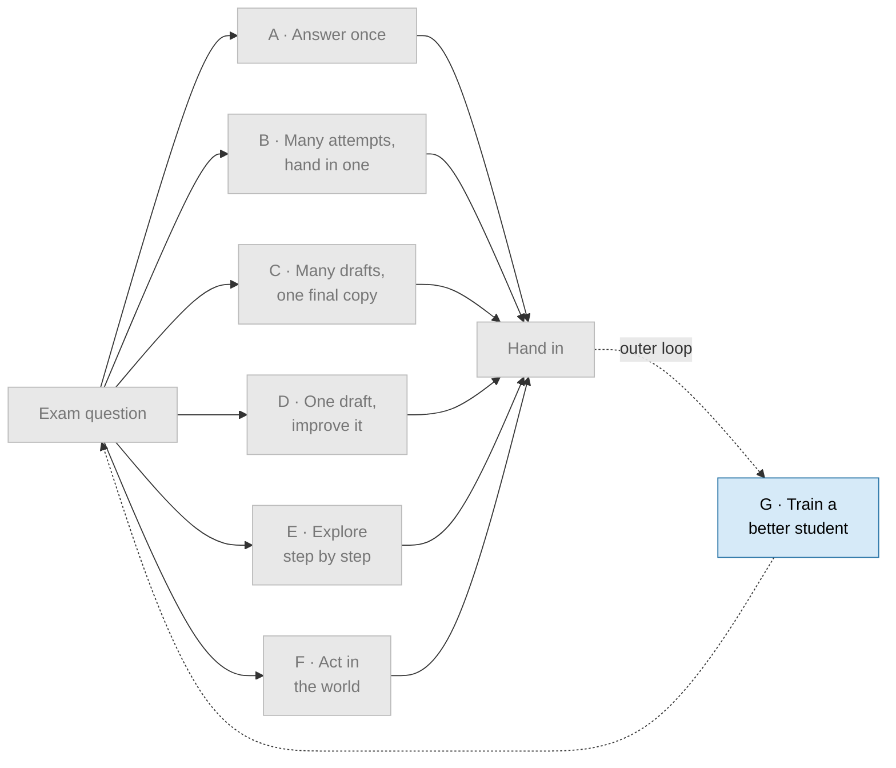

**What we're doing here, and why.** Families A–F improve the *answer*. Family G improves the *model*, by training it on feedback — Lecture 4's *outer loop* (L4 [0:33:41]). Lecture 1 calls feeding compute spent at answer time back into training "the self-improving piece" (L1 [0:29:38]).

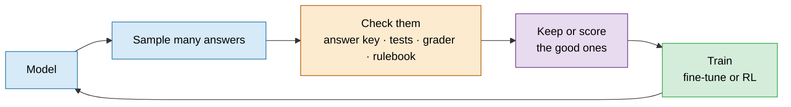

### G1 · Pre-training — "read the whole library"
- **How:** predict the next token over huge amounts of text. Loss falls predictably as compute, data and parameters grow (L1 [0:02:07]–[0:04:10]).
- ✅ Predictable; built every base model from BERT to GPT-4.
- ❌ The result can't follow instructions or tell right from wrong, and scaling it alone was hitting "some kind of a saturation point" (L1 [0:02:07]–[0:04:10]).

### G2 · Fine-tuning and instruction tuning — "tutoring"
- **How:** continue training on much better text, then on instruction + question–answer pairs, some with worked reasoning (L1 [0:12:17]–[0:16:22]).
- ✅ Turns a text predictor into an instruction-following assistant.
- ❌ Quality data is expensive: "millions of dollars or hundreds of millions of dollars potentially" (L1 [0:14:21]).

### G3 · RLHF — "a tutor who learned the teacher's taste"
- **How:** humans rate or compare answers; a reward model learns to imitate those ratings ("this reward model is instead of human"); RL pushes the model toward answers it scores highly. Several rewards — correctness, helpfulness, specificity, harmlessness — can be weighted (L1 [0:16:22]–[0:18:24]; L4 [0:47:02]).
- ✅ A core ingredient of ChatGPT (L1 [0:10:13]–[0:19:25]).
- ❌ Tens of thousands of human labels don't scale (L4 [0:47:02]); alignment is "still a big problem" (L1 [0:12:17]).

### G4 · The data engine — "re-solve practice problems, keep the attempts that matched the answer key, study those"
- **How:** sample many solutions to problems with known answers (math) or checkable ones (code), keep the good ones, fine-tune on them, repeat (L1 [0:27:35]–[0:29:38]). The lecturers present this as how reasoning models such as DeepSeek, o1 and Gemini Thinking combine fine-tuning with compute at answer time.
- ✅ Open-ended self-improvement, driven by cheap checks.
- ❌ Needs checkable answers, and how far it can go is open (L1 [0:29:38]). Lecture 1 also credits RL with verifiable rewards for recent progress in coding agents (L1 [0:48:55]).
- **Example:** keep the four attempts that reached 108 and train on them.

### G5 · Training the graders themselves
- **Outcome grader from answer keys** (Cobbe et al.): see B3 (L3 [0:03:13]–[0:07:19]).
- **Step grader from human labels** (*Let's Verify*): see B4 (L3 [0:25:43]–[0:26:44]).
- **Step grader without humans** (*Math-Shepherd*): a step is good if it can still lead to the right answer. From the step, roll out N continuations: the *hard* label is 1 if any reaches the right answer; the *soft* label is the fraction that do. With N = 3 and two successes: hard 1, soft 2/3 (L3 [0:38:58]–[0:42:02]).
  - ✅ No human annotation, only final answers. The resulting grader beat self-consistency, an outcome grader and, on MATH, the human-labelled one (L3 [0:44:09]).
  - ❌ A valid but unusual step can get 0 when N is small; hard problems give no signal; a wrong middle step still gets 1 if the rollouts recover (L3 [0:40:59]–[0:43:03]).

### G6 · RL against a step grader — "train the student to please the line-by-line grader"
- **How:** use the step grader's scores as the reward and train the generator with PPO (Math-Shepherd, on Mistral-7B) (L3 [0:46:10]–[0:47:14]).
- ✅ Beat RL with an outcome-grader reward, and grading on top of the trained model added more (L3 [0:47:14]).
- ❌ The RL gain was smaller than the gain from grading at answer time, and gains plateau (L3 [0:47:14]).
- ❌ Training against a grader invites gaming it — for example skipping reasoning that the grader can't see is missing. Using a grader only to *pick* leaves the student unchanged (L3 [0:34:54]–[0:36:54]).

### G7 · RLEF training — "coding practice that teaches you to use error messages"
- **How:** run D3's loop on many problems (CodeContests) and update the model with PPO. The final program is graded on hidden tests: +1 if all pass, −1 otherwise. The value estimate is made once per turn and shared by every token in that response (L4 [0:28:37]–[0:34:42]).
- ✅ After training, wrong outputs fall from turn 1 to turn 3 and the repairs become targeted at the error (L4 [0:35:44]–[0:36:47]).
- ❌ Needs executable tests, and RL training is costly. Whether a pass/fail reward is enough for harder tasks — or whether they need error traces or step-level rewards — is open (L4 [0:39:49]).

### G8 · Constitutional AI — "a rulebook, self-critique, and rewrites as study notes"
- **How:** humans write 16 principles instead of labelling tens of thousands of comparisons (L4 [0:48:02]).
  - *Supervised stage:* the model critiques its answer against one principle, rewrites it, and is fine-tuned on the rewrites (L4 [0:49:04]).
  - *RL stage:* an AI compares answers using the constitution; those AI labels train a preference model, which is the RL reward (L4 [0:51:04]).
- ✅ Replaces the bulk of human feedback. With chain of thought it gave the best trade-off between helpfulness and harmlessness (the *Pareto frontier*) (L4 [0:58:15]).
- ❌ The AI labels still need checking against human judgements on a held-out set (L4 [0:57:14]). Self-critique is limited by overconfidence, and other models may critique better (L4 [0:59:16]).

---

## 10. Side-by-side comparison

Calls are per question at answer time; the training cost of families A3 and G is paid once, beforehand.

| | Architecture | Lectures | Calls per question | Training needed? | Shape | Best when | Main weakness |
|---|---|---|---|---|---|---|---|
| A1 | Zero/few-shot | L1 | 1 | no | single | quick baseline | one draw, no recovery |
| A2 | Chain of thought | L1, L4 | 1, longer | no | single | large models, math | memory only, hallucinates |
| A3 | Reasoning model | L1 | 1, very long | done by the lab | internal loop | math, code, analysis | expensive traces |
| B1 | Sampling + automatic checker | L1, L2 | k + checks | no | parallel | code, formal math | needs a checker |
| B2 | Majority vote | L2, L3, L4 | k | no | parallel | exact short answers, easier sets | plateaus; misses rare right answers |
| B3 | Best-of-N + outcome grader | L2, L3 | N + N scores | a grader | parallel | right answer is a minority | fooled at large N; outcome only |
| B4 | Best-of-N + step grader | L2, L3 | N + N step scores | a grader, step labels | parallel | rare right answers; shifted test sets | label cost; domain-bound |
| B5 | LLM judge | L1, L3 | N + N, or N + 1 comparative | no | parallel | no checker exists | weak alone; overconfident |
| B6 | Weaver panel | L3 | N × verifiers | weights, few labels | parallel | small models, hard sets | cost; independence assumption |
| C | Fuse / rank / stack (Archon) | L2 | N + several | no; optional search | layers | open-ended answers | many calls; can garble |
| D1 | Sequential revision | L2 | 1 + revisions | no | sequential | easier problems | slower; unclear on hardest |
| D2 | Critique → rewrite | L2, L4 | 3 per round | no | sequential | rescuing wrong drafts | regressions; weak critic |
| D3 | Execution-feedback loop | L4 | up to 3 + test runs | no | sequential | code | needs tests |
| D4 | Compute-optimal mix | L2 | varies | no | mixed | fixed budget, mixed difficulty | needs a difficulty estimate |
| E1 | Step-grader beam search | L2 | width × depth | a step grader | tree | step-by-step problems | only as good as the grader |
| F2 | ReAct | L4 | steps × (call + tool) | no | loop | facts, current information | errors compound |
| F3 | ReAct ↔ voting | L4 | ReAct + k | no | hybrid | mixed knowledge | complexity |
| G3 | RLHF | L1, L4 | 1 | yes, human labels | outer loop | alignment | label cost |
| G4 | Data engine | L1 | 1 | yes | outer loop | checkable tasks | needs answer keys |
| G6 | RL vs step grader | L3 | 1 | yes | outer loop | step-checkable math | gaming; plateau |
| G7 | RLEF | L4 | up to 3 | yes, PPO | inner + outer | code | costly RL; needs tests |
| G8 | Constitutional AI | L4 | 1 | yes, AI labels | outer loop | harmlessness at scale | self-judging needs a human check |

---

## 11. Ten lessons that cut across the lectures

1. **Knowing which answer is right is often harder than producing one** — where no automatic checker exists (L2 [0:14:38]–[0:18:48]; L3 [0:00:05]). In checkable domains it can be the other way round (L2 [0:12:32]).
2. **Every loop is only as good as its feedback.** Ask where the feedback comes from and how far you can trust it (L4 [0:01:05]). Roughly, from most to least trustworthy: automatic checkers, trained graders, LLM judges and self-critique *(my note, consistent with L1–L4)*.
3. **More attempts are not free, and can backfire.** Cost grows with every attempt, voting plateaus, and an imperfect grader eventually gets fooled (L2 [0:16:39]; L3 [0:14:26]).
4. **Pick with a grader before you train against it.** Picking leaves the model unchanged; training can teach the model to game the grader (L3 [0:34:54]–[0:36:54]). Picking isn't immune either: the drop at 800 samples is the grader being fooled.
5. **Parallel vs sequential is the basic design choice** (L2 [0:26:55]). Parallel gives diversity and low waiting time but can't fix a consistent error; sequential builds on feedback but is slower and can break a right answer *(my note)*. Fusion mixes both: parallel samples, then one sequential step (L2 [0:49:25]).
6. **Difficulty decides the strategy.** Revise on easy problems; on the hardest, a bigger model may beat any trick at answer time (L2 [0:34:02]–[0:42:22]).
7. **Compare methods at matched cost, by one final answer.** Count calls or tokens; coverage is a ceiling, not a score (L2 [0:36:04], [0:57:38]; L3 [1:02:41], [1:05:44]).
8. **Models are overconfident about their own work**, so self-judging needs outside checks (L4 [0:13:13], [0:59:16]).
9. **Long chains of actions compound errors** (L4 [0:21:22]).
10. **Inner loop vs outer loop.** Work at answer time improves one answer; training improves the model. The course's "self-improvement" is feeding the first into the second (L1 [0:27:35]–[0:29:38]; L4 [0:33:41]).

---

## 12. Which architecture when?

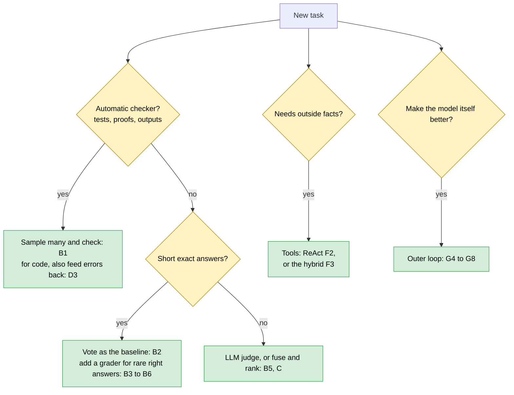

Two more rules from Lecture 2: on easy problems, revising (D1) is the best use of compute; on the hardest problems, a stronger model may beat anything you do at answer time (D4) (L2 [0:34:02]–[0:42:22]).

---

## 13. Homework 1 map

| § | Points | What you build | Family | Calls per problem | What the lectures lead you to expect |
|---|---|---|---|---|---|
| 1 | 10 | one answer from a step-by-step prompt | A2 — the chain-of-thought baseline | 1 | the pass@1 baseline |
| 2 | 30 | majority vote at n = 1, 2, 4, 8, 16 | B2 | n | rises, then flattens below coverage |
| 3 | 30 | an LLM reads all 16 solutions and restates the one it believes | B5 used comparatively; fusion-like (C1) | 16 + 1 | can find a minority-correct answer; can also garble one |
| 4 | 45 | generate → critique → regenerate | D2, RLEF-inspired but prompting only | 3 | fixes some wrong answers, may break some right ones |
| 5 | 15 | accuracy against number of calls; parallel vs sequential | lessons 3, 5, 7 | — | compare at matched cost |

Notebook settings worth knowing: samples at temperature 0.7, the aggregator at 0, the critic at 0.3.

**Rules and traps**
- **The answer key only grades.** Like RLEF's hidden tests, it must never feed the attempts (L4 [0:31:38], [0:41:52]). Keep it out of every judge, critic and rewrite prompt.
- **Measure your own gap** *(my suggestion, not required)*: from your §2 samples, compute coverage@16 (was any of the 16 right?). Coverage@16 minus majority@16 is your generation–verification gap, a good number for §5.
- **30 problems means one problem is worth 3.3 points.** Differences of one or two problems are noise.
- **n = 2 in §2:** when the two answers differ, your tie-break rule decides, so expect n = 2 to look like n = 1 *(my note)*.
- **§4 has no stop signal:** count both fixes and regressions.
- **Failed API calls come back as "Error: …" strings and are scored as wrong.** Count them before trusting any accuracy.

---

## 14. Open questions the lectures leave open

- Does RL teach new abilities, or only sharpen what pre-training already put there? No consensus (L1 [0:50:56]–[0:51:57]).
- The best mix of revising and sampling on hard problems (L2 [0:37:06]).
- The best size ratio between generator and grader (L3 [0:13:24]).
- How to split a fixed budget between more attempts and more verifiers (L3 [1:05:44]).
- Outcome vs step-level rewards for RL on harder tasks (L4 [0:39:49]).
- Calibration: can a model know what it knows? (L4 [0:13:13])
- Sharpening pass@1 without losing the diversity of solutions (L3 [1:09:53]–[1:10:53]).
- Letting difficulty decide how many samples to draw (L1 [0:39:50]). The lecturers knew of no work doing exactly this; Snell et al., a Lecture 2 reading, does adapt compute to difficulty *(my note)*.

---

## 15. Glossary

| Term | Meaning |
|---|---|
| pass@1 | the chance that one attempt is right |
| pass@k, coverage | the chance that at least one of k attempts is right; what a perfect checker would score |
| oracle | a chooser that peeks at the answer key — a ceiling, not a method |
| generation–verification gap | coverage minus the accuracy your chooser actually achieves |
| verifier | anything that judges an answer: rule-based (tests, answer match) or learned (reward models, LLM judges) |
| ORM | outcome reward model: scores a whole solution; trained on final-answer labels |
| PRM | process reward model: scores each step |
| reward model | a model trained to score outputs; used to pick, or as an RL reward |
| LLM-as-a-judge | a prompted LLM deciding whether, or which, answer is good |
| self-consistency (CoT-SC) | majority voting over chain-of-thought samples |
| temperature | how random generation is; higher means more varied attempts |
| test-time (inference) compute | compute spent while answering, with the model's weights unchanged |
| parallel vs sequential | independent attempts vs improving one attempt |
| inner vs outer loop | improving this answer vs improving the model |
| reward hacking | the model learns to please the grader instead of being right |
| distribution shift | test problems that differ from the training problems |
| weak supervision | combining many noisy labelers into one stronger label |
| Pareto frontier | the best achievable trade-off curve between two goals |
| RLHF, RLAIF | RL from human feedback, from AI feedback |
| PPO | the RL algorithm behind RLHF, RLEF and Math-Shepherd's RL |
| calibration | whether a model's confidence matches how often it is right; LLMs tend to be overconfident (L4 [0:13:13]) |

---

## 16. Official readings

From the course schedule ([cs329a.stanford.edu](https://cs329a.stanford.edu/#schedule)). Lecture 1 has none.

- **L2:** [Large Language Monkeys](https://arxiv.org/abs/2407.21787) · [Archon](https://arxiv.org/abs/2409.15254) · [Scaling LLM Test-Time Compute Optimally can be More Effective than Scaling Model Parameters](https://arxiv.org/abs/2408.03314) (Snell et al.) · [How Do Large Language Monkeys Get Their Power (Laws)?](https://arxiv.org/abs/2502.17578)
- **L3:** [Shrinking the Generation-Verification Gap with Weak Verifiers](https://arxiv.org/abs/2506.18203) (Weaver) · [Training Verifiers to Solve Math Word Problems](https://arxiv.org/abs/2110.14168) (Cobbe et al.) · [Let's Verify Step by Step](https://arxiv.org/abs/2305.20050) · [Math-Shepherd](https://arxiv.org/abs/2312.08935)
- **L4:** [ReAct](https://arxiv.org/abs/2210.03629) · [RLEF](https://arxiv.org/abs/2410.02089) · [Constitutional AI](https://arxiv.org/abs/2212.08073)
